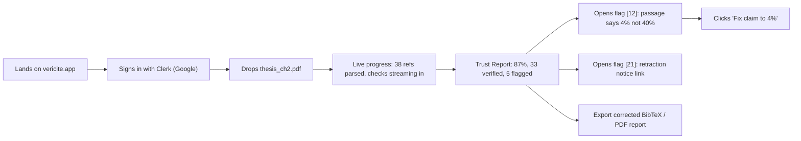

# 02 — Users, Journeys & Pain Points

## Personas

### P1 · Riya — UG/PG student (primary, Phase 1)
- 3rd-year B.Tech, writing a mini-project report and a literature review with ChatGPT/Gemini help.
- **Pain:** can't tell real references from invented ones; afraid of being flagged by faculty; no time to open 30 PDFs.
- **Job to be done:** "Before I submit, tell me which references are fake or wrong, and fix them for me."
- **Success:** uploads PDF, gets a report in ~2 minutes, exports a corrected `.bib`.

### P2 · Arjun — PhD scholar / researcher (primary, Phase 1)
- Submitting to a top venue / arXiv. Manages references in Zotero → `.bib`.
- **Pain:** one fake reference now risks desk rejection or a one-year arXiv ban; claims cite papers for numbers they don't actually report.
- **JTBD:** "Audit my bibliography and confirm each cited paper actually supports the sentence I cite it for."
- **Success:** catches the "40% vs 4%" misquote and a retracted paper before submission.

### P3 · Dr. Meera — reviewer / editor / conference PC member (secondary)
- Reviews 6–10 papers per cycle.
- **Pain:** hallucinated citations passed 3+ reviewers at NeurIPS 2025; manual checking is impossible at scale.
- **JTBD:** "Screen every submission's references in minutes, with evidence I can paste into my review."
- **Success:** shareable report link attached to the review.

### P4 · Prof. Sharma / university library — faculty & integrity office (secondary → P2 feature)
- **Pain:** integrity checks on assignments are manual and slow; plagiarism tools miss fabricated references.
- **JTBD:** "Batch-check a whole class and see an institution-wide dashboard."

### P5 · Kabir — student journalist / debate club (secondary)
- **Pain:** viral claims spread before anyone verifies them.
- **JTBD:** "Is this claim true *right now*? Show me today's sources." → Grounded Answer + Current check. (Mobile share-sheet in Phase 2.)

## Pain point map

| Pain | Severity | Frequency | Who | VeriCite answer |
|------|----------|-----------|-----|-----------------|
| Fake / hallucinated references | Critical | Very high with AI drafting | P1, P2, P3 | **Exists** check via TinyFish Search `research_paper` |
| Wrong metadata (year/venue/authors) | Medium | High | P1, P2 | Field-level diff + corrected BibTeX |
| Source doesn't say what's claimed | High | High | P2, P3 | **Supports** check: Fetch full text, judge + verbatim quote |
| Citing retracted work unknowingly | High | Medium | P2, P3, P4 | **Valid** check: retraction notices via Search/Fetch/Agent |
| Stale or disputed news claims | Medium | High | P5, P1 | **Current** check: news search with `recency_minutes` |
| Manual checking takes hours | High | Always | All | Parallel pipeline, ~2 min per 40-ref paper |
| Can't trust AI answers | High | Always | All | **Grounded Answer**: only from pages fetched seconds ago |
| No evidence to show others | Medium | Often | P3, P4 | Evidence on every flag, share link, PDF export |

## User journeys

### J1 · Pre-submission audit (Riya / Arjun) — **the demo journey**

| Step | User does | System does | Emotion | Moment of truth |
|------|-----------|-------------|---------|-----------------|
| 1 | Uploads PDF | Stores in Supabase Storage, creates run | Anxious | Upload is instant, no form |
| 2 | Watches progress | Gemini parses refs → LLM links claims → TinyFish checks in parallel | Curious | Rows flip from "checking" to verdicts in real time |
| 3 | Reads summary | Trust score + counts | Relief or alarm | Summary first, no wall of text |
| 4 | Opens a flag | Evidence panel: quote, source link, which API found it | Convinced | "It shows me the exact passage" |
| 5 | Fixes | One-click fix / corrected BibTeX | Empowered | Leaves with a fixed file |

### J2 · Bibliography-only check (Arjun)
Upload `.bib` → Exists + Valid checks (no claims, so Supports is skipped and labelled "no claim context") → corrected `.bib` export with canonical metadata and DOIs filled in.

### J3 · Reviewer screening (Dr. Meera)
Paste the submission's reference list + key claims → report → **Share link** (read-only public URL) pasted into the review.

### J4 · Grounded Answer (Kabir)
Types "Has the WHO declared mpox a public health emergency again?" → VeriCite creates search queries → TinyFish Search (`news` + `web`) → Fetch top pages → answer where every sentence has a `[n]` source with a timestamp → copy/share.

### J5 · Mobile (Phase 2)
Sees a viral claim on WhatsApp → Share → VeriCite → Grounded Answer / Current check → verdict card. Or photographs a printed reference list → OCR → Exists check.

## Key insights driving design

1. **Summary first, evidence one tap away.** Users decide in seconds; reviewers need proof.
2. **Show the work.** Display which TinyFish API produced each piece of evidence. This builds trust and shows judges the integration.
3. **Fixes, not just flags.** Corrected BibTeX turns a scary report into a useful tool.
4. **Honest uncertainty.** Paywalled → "partially verified", never a fake "supported".
