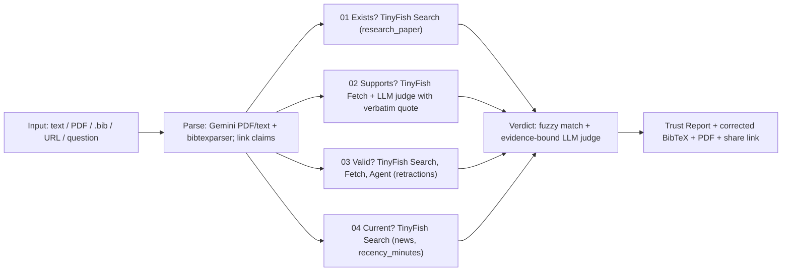

# 03 — Solution & Impact

## The solution

**Drop in any input, and VeriCite runs four live checks on every reference.**

Inputs: pasted draft · PDF (paper/thesis) · `.bib` file · link to a paper · a research question.

### The four checks

| Check | How | Possible flags |
|-------|-----|----------------|
| **01 Does it exist?** | Title/authors/year/venue matched against live scholarly search (TinyFish Search, `domain_type="research_paper"`). Invalid IDs such as `arXiv:2305.XXXX` are caught instantly | `not_found`, `metadata_mismatch` |
| **02 Does it say that?** | Fetch the cited paper (PDF/abstract) with TinyFish Fetch; the LLM must quote the passage that supports or contradicts the claim; the quote is verified against the fetched text | `unsupported`, `contradicted` |
| **03 Is it still valid?** | Look for retraction/correction notices: Search → Fetch the DOI landing page → escalate to TinyFish **Agent** only when signals are ambiguous | `retracted`, `corrected` |
| **04 Is it current?** | Check time-sensitive claims against news from the last few hours/days (TinyFish Search `news` + `recency_minutes`) | `outdated`, `disputed` |

### Grounded Answer mode
Ask a question; the LLM answers **only** from pages TinyFish fetched seconds ago, every sentence linked to its source. Unsupported sentences are dropped, not guessed.

### The Trust Report
- **Summary first:** counts + trust score (e.g. *38 checked · 33 verified · 5 flagged · Trust 87%*).
- **Every flag opens its evidence:** quote, source URL, publisher/date, and which TinyFish API produced it.
- **One-click fixes:** "Fix claim to 4%", replace with canonical metadata, corrected BibTeX export.

## Why we win

| Judging axis | Our answer |
|--------------|------------|
| **TinyFish usage** | All three APIs in one pipeline, each used for what it's best at: Search (structured scholarly + news JSON, `purpose`, `include_domains`, `recency_minutes`), Fetch (browser-rendered full text, batched 10 URLs), Agent (publisher-page navigation for retractions, budget-capped). A live usage meter in the UI |
| **Innovation** | First tool to combine existence + claim support with a verbatim quote + retraction + live news currency in one report. "No quote, no supported" rule |
| **Execution** | Working web app, real uploads, real-time progress, exports, deployed |
| **Scalability** | Stateless workers behind a queue, shared reference cache (verify once, reuse for all), rate-aware scheduler, ETag-based watch mode |
| **Impact** | 4.14 crore students, every researcher, every reviewer; a concrete, measurable failure (NeurIPS 2025) |

## Differentiators

1. **Evidence-bound verdicts.** No verbatim quote, no "supported" verdict.
2. **Live, not indexed.** TinyFish fetches pages now, so it catches retractions posted this morning and news from the last hour.
3. **Fixes, not only flags.** Corrected BibTeX, claim fixes.
4. **Model-agnostic.** The LLM is swappable; truth comes from the fetched web.
5. **Free to run.** Core checks run on TinyFish's free Search/Fetch tier (₹0 API cost for core checks).

## Impact

### Who benefits
| Segment | Size (India) | Use |
|---------|--------------|-----|
| Students (UG/PG) | 4.14 crore (AISHE 2020-21) | Pre-submission audit, corrected BibTeX |
| Institutions | 43,796 colleges · 1,113 universities | Batch screening, integrity dashboard (P2) |
| Researchers & reviewers | Global | Pre-submission audit, review screening with evidence |
| Journalists & debaters | — | Live fact-check against the last few hours of news |

### Measurable outcomes (targets)
| Metric | Today | With VeriCite (target) |
|--------|-------|------------------------|
| Time to verify a 40-reference paper | 2–4 hours manual | **~2 minutes** |
| Ghost-citation detection recall on eval set | n/a | **≥ 95%** |
| False "not found" on real papers | n/a | **≤ 5%** |
| Retracted citations surfaced | 14% mention retraction (86% don't) | **100% of retractions with public notices** |
| Marginal API cost per paper (core checks) | — | **₹0** on free tier |

### Second-order impact
- Restores trust in peer review and student work in the AI era.
- Reduces the spread of retracted science.
- Teaches citation hygiene: the report explains *why* each reference failed.

## Roadmap

| Stage | When | What |
|-------|------|------|
| Design | Done | Architecture + Figma prototype (Round 1) |
| **MVP** | **24 h (finale)** | Web app, live test on 100 known fakes |
| Pilot | 3 months | Flutter app, Chrome extension, library pilot |
| Scale | 12 months | Overleaf/Word/Zotero plugins, institution dashboard, public API, watch mode |

## Business model (pitch only)
Free for students (fair-use limits) · Pro for researchers (unlimited, watch mode) · Institution licence (batch + dashboard + LMS integration) · API for publishers and conferences (submission screening).
