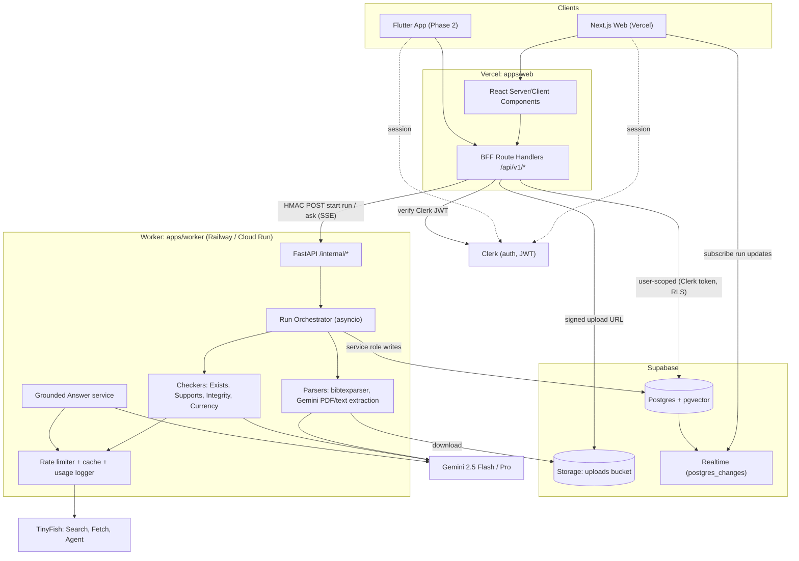
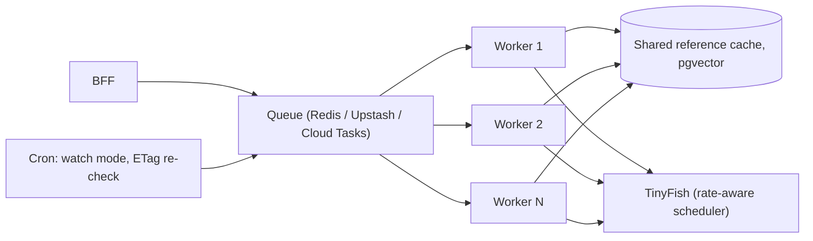

# 05 — Architecture

## 1. System overview



### Responsibilities

| Component | Owns | Does NOT do |
|-----------|------|-------------|
| **apps/web (Next.js)** | UI, auth gating, BFF API, creating runs, exports (BibTeX/PDF), share links | Any TinyFish/LLM calls (except proxying the ask SSE) |
| **Clerk** | Identity, sessions, JWT for Supabase | Data |
| **Supabase** | Source of truth for runs/citations/evidence, file storage, realtime fan-out | Business logic |
| **apps/worker (FastAPI)** | Parsing, all TinyFish calls, LLM calls, verdicts, trust score, caching | Auth of end-users (trusts BFF via HMAC) |
| **Gemini PDF extraction** | PDF bytes → references, citing claims, and context via structured output | Web retrieval or evidence verification |

## 2. Run lifecycle (document verification)

```mermaid
sequenceDiagram
  autonumber
  actor U as User
  participant Web as Next.js (BFF)
  participant SB as Supabase
  participant Wk as Worker
  participant TF as TinyFish
  participant L as Gemini

  U->>Web: Upload PDF (signed URL) / paste / .bib
  Web->>SB: PUT file to Storage (signed URL)
  Web->>SB: INSERT runs (status=queued)
  Web->>Wk: POST /internal/runs/{id}/start (HMAC)
  Wk-->>Web: 202 Accepted
  Web-->>U: redirect /app/runs/{id}
  U->>SB: Realtime subscribe (runs, citations by run_id)
  Wk->>SB: status=parsing
  Wk->>L: Extract PDF references + claims (JSON schema)
  L-->>Wk: Structured references + citation markers
  Wk->>L: link claims to citations (JSON schema)
  Wk->>SB: INSERT citations, claims; status=checking
  par per citation, bounded concurrency
    Wk->>TF: Search research_paper(title)
    TF-->>Wk: candidates JSON
    Wk->>Wk: RapidFuzz match -> existence verdict
    Wk->>TF: Fetch(pdf_url / landing)
    Wk->>L: judge(claim, fulltext) -> verdict + quote
    Wk->>Wk: verify quote in text
    Wk->>TF: Search/Fetch retraction signals
    opt ambiguous and budget left
      Wk->>TF: Agent.run(doi_url, goal="find retraction notice")
    end
    Wk->>SB: UPDATE citation + INSERT evidence
    SB-->>U: realtime row update
  end
  Wk->>SB: trust_score, counts, status=completed
```

## 3. Grounded Answer flow

```mermaid
sequenceDiagram
  actor U as User
  participant Web as Next.js
  participant Wk as Worker
  participant TF as TinyFish
  participant L as Gemini
  U->>Web: POST /api/v1/ask {question}
  Web->>Wk: POST /internal/ask (HMAC), stream
  Wk->>L: plan queries (2-4) + domain types
  Wk->>TF: Search x N (parallel)
  Wk->>TF: Fetch top 4-8 URLs (1 batched call)
  Wk-->>Web: SSE event: sources
  Wk->>L: answer ONLY from fetched pages, cite [n] + quote per sentence
  Wk->>Wk: validate each quote in its source; drop failures
  Wk-->>Web: SSE events: sentence ... done
  Web-->>U: streamed answer with [n] chips
```

## 4. Worker internals

```
apps/worker/app/
├── main.py                 # FastAPI app, routes, HMAC dependency
├── config.py               # pydantic-settings, env vars
├── models.py               # Pydantic models mirroring docs/09 enums
├── db.py                   # Supabase client (service role) + repo helpers
├── clients/
│   ├── tinyfish.py         # AsyncTinyFish wrapper: limiter, retries, cache, usage log
│   ├── llm.py              # LLM provider interface + Gemini impl (structured output)
├── parsing/
│   ├── bib.py              # .bib -> ParsedRef
│   ├── pdf.py              # Gemini direct PDF extraction -> refs + claims
│   ├── text.py             # pasted text -> refs + claims (Gemini)
│   └── identifiers.py      # DOI/arXiv regex + validation
├── checks/
│   ├── exists.py           # ExistenceChecker
│   ├── supports.py         # SupportChecker
│   ├── integrity.py        # IntegrityChecker (with escalate())
│   └── currency.py         # CurrencyChecker
├── engine/
│   ├── orchestrator.py     # run pipeline, concurrency, status updates
│   ├── verdict.py          # roll-up status + trust score
│   ├── matching.py         # RapidFuzz scoring
│   └── bibtex.py           # corrected BibTeX generation
├── answer/
│   └── grounded.py         # Grounded Answer service (SSE generator)
└── prompts/                # *.md prompt templates (versioned)
```

### Concurrency model
- One `asyncio.Task` per run. Inside, a `Semaphore(CITATION_CONCURRENCY=8)` bounds concurrent citations.
- Per-API rate limiters (`aiolimiter.AsyncLimiter`): Search `TINYFISH_SEARCH_RPM` (default 30/min), Fetch batched to ≤ 10 URLs per call, Agent `Semaphore(2)` + per-run cap.
- **Batching:** Exists runs first for all citations; then all fetchable URLs are grouped into Fetch calls of 10; then Support judgements run in parallel against the cached text.
- Idempotent start: if `runs.status != queued`, `/start` is a no-op.
- On worker restart, runs stuck in `parsing/checking` > 10 min are marked `failed` with reason (MVP). Scale path: durable queue.

## 5. Data flow & storage

| Data | Where | Retention |
|------|-------|-----------|
| Uploaded PDFs / .bib | Supabase Storage `uploads/{owner_id}/{run_id}/{filename}` | 7 days (P1 cron) |
| Parsed refs, claims, verdicts, evidence | Postgres tables (see [09](09-data-model.md)) | Until user deletes |
| Fetched full text | Not stored in full; only quotes + URL. `reference_cache.fulltext_url` | Cache 7 days |
| Canonical metadata & integrity | `reference_cache` (shared across users, no PII) | 7 days TTL, ETag recheck |

## 6. Security boundaries
- Browser → Supabase: Clerk JWT, RLS-enforced, **read-only** on run data for the user (writes go via BFF/worker).
- BFF → Worker: `X-VeriCite-Signature: HMAC_SHA256(WORKER_SHARED_SECRET, timestamp + body)` + `X-VeriCite-Timestamp` (±5 min).
- Worker → Supabase: service role key (server-only).
- Public share `/r/[shareId]`: server-side fetch with service role, filtered by `share_id`, read-only, no owner info.

## 7. Scale path (pitch)


- Stateless workers scale horizontally behind a queue.
- **Shared cache**: popular papers (e.g. "Attention Is All You Need") are verified once and reused by every user; pgvector title embeddings give semantic cache hits for slightly different titles.
- **Rate-aware scheduler**: token buckets per TinyFish API, Fetch batches of 10.
- **Watch mode**: cron re-fetches DOI landing pages using ETag/Last-Modified; new retraction → notify owners of affected runs.
