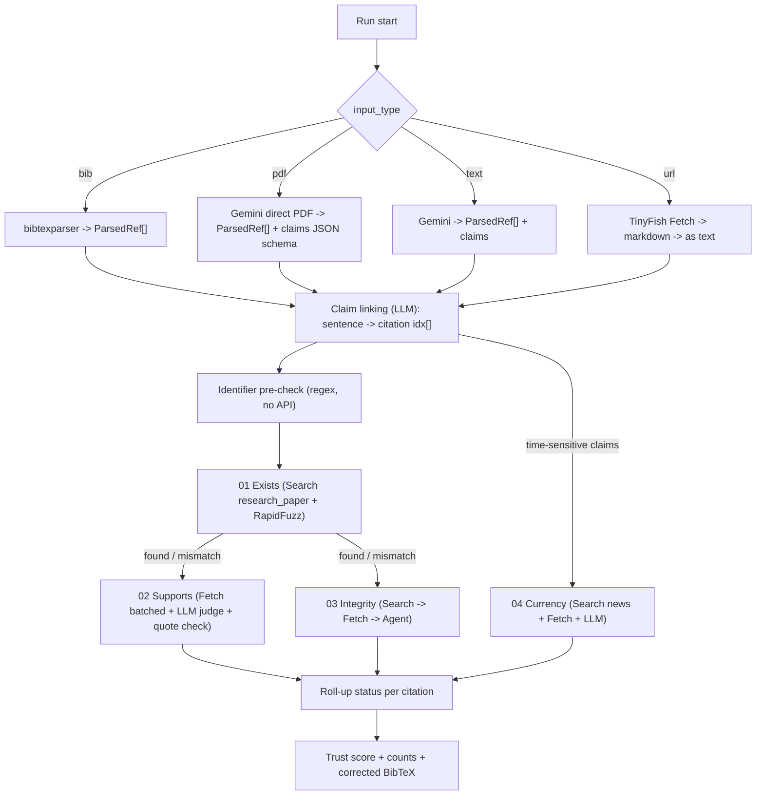
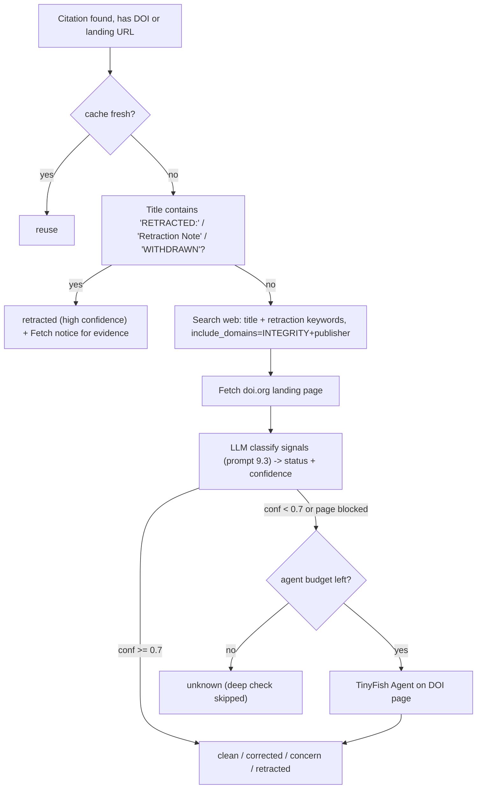

# 08 — Verification Engine

The brain of VeriCite (`apps/worker`). This doc defines parsing, each checker, verdict logic, trust score, prompts, and BibTeX correction. Enum values here **must** match [09-data-model.md](09-data-model.md).

## 1. Pipeline



## 2. Parsing

### 2.1 `ParsedRef` (Pydantic)
```python
class ParsedRef(BaseModel):
    idx: int                    # 1-based order in bibliography
    key: str | None             # bibtex key if any
    raw: str                    # original reference string
    title: str | None
    authors: list[str] = []     # "Lastname, F." or full names
    year: int | None
    venue: str | None
    doi: str | None
    arxiv_id: str | None
    url: str | None
    entry_type: str | None      # article, inproceedings, misc...
```

### 2.2 Sources
- **.bib** → `bibtexparser`; normalise LaTeX (`{\"o}` → ö, strip braces); `raw` = re-serialised entry.
- **PDF** → Download the private object from hosted Supabase Storage using the worker service role; pass PDF bytes to Gemini through `clients/llm.py` with `application/pdf` and a `response_schema` for `{references: ParsedRef[], claims: Claim[]}`. Copy raw references and claim text; never invent missing metadata. No Docker, GROBID, or raw web scraping is used. Extraction failure must fail the parsing stage explicitly.
- **Text** → Gemini extraction with the same schema. If no references section exists, return `references: []` and treat the run as claims-only (Currency check + note).

### 2.3 Claim linking
For each body sentence containing a citation marker (`[12]`, `(Rao, 2019)`, `Rao et al. (2019)`), create a `Claim{text, context(prev+next sentence), citation_idxs[]}`. Gemini resolves numeric and author-year citation markers to `idx` in the extraction schema. Cap: **3 claims per citation** (choose the most specific: contains numbers/comparatives first).

**Time-sensitive claim detection** (for Currency): LLM flags claims with `is_time_sensitive=true` when they mention recent events, "currently", "as of", "latest", statistics about ongoing matters, people in office, prices, records. Cap **5 per run** (P1).

## 3. Identifier pre-check (no API cost)

| Pattern | Rule | Result |
|---------|------|--------|
| arXiv new | `^\d{4}\.\d{4,5}(v\d+)?$`, YYMM month 01–12, YY ≥ 07 | valid → confirm via Fetch `arxiv.org/abs/{id}` (title fuzzy ≥ 85) |
| arXiv old | `^[a-z\-]+(\.[A-Z]{2})?/\d{7}$` | valid |
| Placeholder | contains `X{2,}`, `0000.00000`, `xxxx`, `TODO`, `?` | **`not_found`, reason `invalid_identifier`** |
| DOI | `^10\.\d{4,9}/[-._;()/:A-Z0-9]+$` (case-insensitive) | valid → `https://doi.org/{doi}` used later |
| Year | `> current_year + 1` or `< 1600` | metadata flag `implausible_year` |

If the ID is valid but resolves to a **different** paper (title fuzzy < 60) → `metadata_mismatch` with reason `identifier_points_to_different_paper` (classic hallucination pattern).

## 4. Check 01 — Exists

1. Cache lookup: DOI → arXiv → `sha1(normalize(title) + year)`. Hit and < 7 days → reuse.
2. `search_papers(title, year)`; if no title (e.g. raw string only), query = raw string truncated to 200 chars.
3. Score each of the top 5 candidates:

```
norm(s) = lowercase, strip accents, remove punctuation/LaTeX, collapse whitespace
title_score  = rapidfuzz.fuzz.token_sort_ratio(norm(ref.title), norm(c.title)) / 100
author_score = |lastnames(ref)[:3] ∩ lastnames(c)[:3]| / max(1, min(3, |lastnames(ref)|))   (1.0 if ref has no authors)
year_score   = 1.0 if |Δ| == 0, 0.7 if |Δ| == 1 (preprint vs proceedings), 0 otherwise (1.0 if missing)
venue_score  = fuzz.token_set_ratio(norm(venue_alias(ref.venue)), norm(venue_alias(c.venue))) / 100 (1.0 if missing)
composite    = 0.60*title + 0.25*author + 0.10*year + 0.05*venue
```
`venue_alias` maps common abbreviations (NeurIPS ↔ NIPS ↔ Advances in Neural Information Processing Systems, ICML, ICLR, ACL, EMNLP, CVPR, …).

4. Decide with the best candidate:

| Condition | Existence verdict |
|-----------|-------------------|
| `title ≥ 0.90` and `composite ≥ 0.85` | `found` |
| `title ≥ 0.90` and `composite < 0.85` | `metadata_mismatch` (field diffs: authors/year/venue) |
| `0.75 ≤ title < 0.90` and `author_score ≥ 0.67` | `metadata_mismatch` (title differs) |
| else, after the web fallback with `SCHOLARLY_DOMAINS` (same scoring on page titles) | `not_found` |

5. Persist `citations.matched` = canonical metadata `{title, authors, year, venue, doi, url, pdf_url, cited_by_count}` and `citations.field_diffs`. Evidence row: `check=existence`, `api=search`, `source_url=c.url`, `quote=c.snippet`.

## 5. Check 02 — Supports

Preconditions: existence ∈ {found, metadata_mismatch} **and** ≥ 1 linked claim. Otherwise `support=not_applicable` (no claim) or `unverifiable`.

1. **Choose URL:** `pdf_url` → arXiv PDF (`arxiv.org/pdf/{id}`) → landing `url` → DOI URL.
2. **Fetch** in batches of ≤ 10 across citations (`format="markdown"`). Keep text in memory only.
3. **Truncate** to `SUPPORT_MAX_CHARS` (default 400k chars ≈ 100k tokens); if longer, keep abstract + intro + results/conclusion sections + top-8 paragraphs by keyword overlap with the claim (simple BM25 via `rank_bm25` or token overlap).
4. **Judge** with Gemini Flash (prompt §9.2), structured output:
```json
{"verdict":"supported|partially_supported|unsupported|contradicted",
 "quote":"verbatim passage from the paper",
 "explanation":"one sentence",
 "suggested_fix": {"find":"40%","replace":"4%"} | null,
 "confidence": 0.0}
```
5. **Quote verification (mandatory):** `fuzz.partial_ratio(norm(quote), norm(fulltext)) ≥ 90`. Fail → verdict `unverifiable`, explanation "Model could not ground its verdict in the source text."
6. **Escalation:** if `confidence < 0.6` and verdict ∈ {unsupported, contradicted} → re-judge with Gemini Pro; take the Pro result.
7. **Partial text:** if only an abstract was fetched, `supported` is capped to `partially_supported` and the evidence is labelled "abstract only".
8. Citation-level support = worst verdict across its claims (contradicted > unsupported > partially_supported > supported).

## 6. Check 03 — Integrity (retractions & corrections)



Keyword signals (case-insensitive): `retracted`, `retraction`, `withdrawn`, `expression of concern`, `erratum`, `corrigendum`, `correction to`. A Retraction Watch hit whose title fuzzy-matches ≥ 85 is strong evidence.

Integrity verdict enum: `clean | corrected | concern | retracted | unknown`. Evidence: notice URL + quoted notice sentence + API used.

## 7. Check 04 — Currency (P1)

For each time-sensitive claim:
1. LLM turns the claim into a short neutral news query (≤ 12 words).
2. `search_news(query, recency_minutes=run.options.recency_minutes or 10080)`.
3. Fetch top 3 article URLs (one batch).
4. LLM judge (prompt §9.4) → `current | outdated | disputed | no_recent_coverage`, with a quote + publisher + published date per source. Same quote-verification rule.

## 8. Roll-up status & trust score

### Per-citation status (first matching rule wins)

| # | Rule | `status` |
|---|------|----------|
| 1 | existence = `not_found` | `not_found` |
| 2 | integrity = `retracted` | `retracted` |
| 3 | support ∈ {`contradicted`, `unsupported`} | `not_supported` |
| 4 | existence = `metadata_mismatch` **or** integrity ∈ {`corrected`, `concern`} | `needs_review` |
| 5 | support ∈ {`partially_supported`, `unverifiable`} **or** integrity = `unknown` with existence `found` and claims present | `partially_verified` |
| 6 | existence = `found` and support ∈ {`supported`, `not_applicable`} and integrity ∈ {`clean`, `unknown`} | `verified` |
| 7 | any check `error` and none of the above | `error` |

"Flagged" = `not_found + retracted + not_supported + needs_review`.

### Trust score
```
trust_score = round(100 * (verified + 0.5 * partially_verified) / max(1, checked))
checked     = citations whose status != error
```
Deck example: 33 verified / 38 checked → **87%**. Colour bands: ≥ 85 good, 60–84 caution, < 60 poor (text label + icon, not colour alone).

## 9. Prompts (store in `apps/worker/app/prompts/*.md`, version in filename)

### 9.1 `extract_v1.md` — references & claims from text/PDF
```
You extract bibliographic references and citing claims from an academic document.
Return ONLY JSON matching the schema. Do not invent fields; use null when unknown.
- references: every entry in the bibliography, in order, idx starting at 1. Copy the raw string exactly.
- claims: sentences in the body that cite a reference. Include the sentence verbatim, and the idx list it cites.
  Mark is_time_sensitive=true only for claims about recent/ongoing events or changing facts.
Never correct or "fix" references. Your job is extraction, not verification.
```

### 9.2 `judge_support_v1.md`
```
You are a strict citation auditor. Decide whether SOURCE TEXT supports CLAIM.
Rules:
1. Use ONLY the SOURCE TEXT. Ignore prior knowledge about this paper.
2. You MUST copy one verbatim passage (<= 60 words) from SOURCE TEXT that is most relevant. Do not paraphrase inside "quote".
3. verdict:
   - supported: the passage states the claim (numbers, direction and scope match).
   - partially_supported: related and consistent but weaker/narrower, or only in the abstract.
   - unsupported: the source does not state it anywhere you can find.
   - contradicted: the source states something incompatible (e.g. different number, opposite direction).
4. If a number/term in the claim differs from the source, give suggested_fix {find, replace} using the source's value.
5. confidence in [0,1].
CLAIM: {{claim}}
CLAIM CONTEXT: {{context}}
CITED AS: {{reference}}
SOURCE TEXT (from {{url}}, fetched {{fetched_at}}):
<<<
{{text}}
>>>
```

### 9.3 `classify_integrity_v1.md`
```
Given search snippets and a publisher landing page for the paper "{{title}}" (DOI {{doi}}),
decide its integrity status: retracted | corrected | concern | clean | unknown.
Only say retracted/corrected/concern if a notice clearly refers to THIS paper (title or DOI match).
Return JSON {status, confidence, notice_url, notice_quote}. notice_quote must be verbatim from the inputs.
```

### 9.4 `judge_currency_v1.md`
```
CLAIM: {{claim}}  (document date: {{doc_date or "unknown"}})
You get recent news articles (publisher, published_at, text). Using ONLY them decide:
current (recent coverage confirms), outdated (newer facts supersede it), disputed (credible sources disagree),
no_recent_coverage. For each source used give a verbatim quote. Return JSON {verdict, explanation, sources:[{url, quote}], confidence}.
```

### 9.5 `answer_plan_v1.md` + `answer_compose_v1.md` (Grounded Answer)
- Plan: produce 2–4 diverse search queries with `domain_type` each (`web|news|research_paper`) and an optional `recency_minutes`.
- Compose:
```
Answer the QUESTION using ONLY the numbered SOURCES. Every sentence must end with one or more [n] markers.
For each sentence also output the verbatim supporting quote per marker (JSON mode: sentences[{text, cites:[{n, quote}]}]).
If the sources don't answer it, say so. Never use outside knowledge. Prefer the most recent sources for time-sensitive facts.
```
Server validates each `quote` against source `n` (partial_ratio ≥ 85); drop failing sentences; renumber; stream.

## 10. Corrected BibTeX

For each citation, emit an entry:
- `verified` / `partially_verified` → original entry with missing `doi`/`url` filled from `matched`.
- `needs_review` + user applied "Use canonical metadata" → canonical title/authors/year/venue/doi.
- `not_found` / `retracted` → kept but commented out with a reason: `% VeriCite: NOT FOUND in live scholarly search (2026-10-25)` unless the user chose "Remove".
- Keys preserved; generated keys = `lastnameYEARfirstword`.
- Header comment: run id, date, trust score.

## 11. Config knobs (env)
`CITATION_CONCURRENCY=8 · TINYFISH_SEARCH_RPM=30 · TINYFISH_FETCH_CONCURRENCY=3 · AGENT_MAX_RUNS_PER_JOB=5 · AGENT_DAILY_CAP=60 · SUPPORT_MAX_CHARS=400000 · CLAIMS_PER_CITATION=3 · CURRENCY_MAX_CLAIMS=5 · CACHE_TTL_DAYS=7 · LLM_MODEL_FAST=gemini-3.8-flash · LLM_MODEL_STRONG=gemini-3.1-pro-preview`
