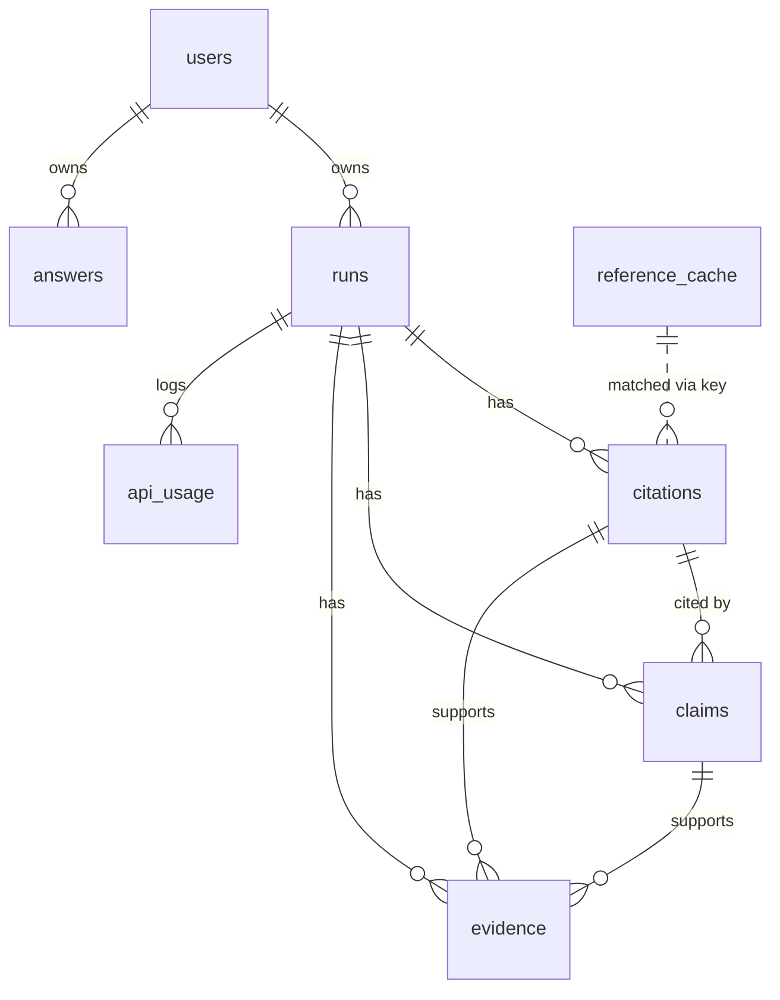

# 09 — Data Model (Supabase / Postgres)

Migrations live in `supabase/migrations/`. This doc is the contract; the first migration should be exactly this SQL (adjust only if Supabase rejects syntax, and update this doc).

## ER diagram



## Enums

| Enum | Values |
|------|--------|
| `input_type` | `text`, `pdf`, `bib`, `url` |
| `run_status` | `queued`, `parsing`, `checking`, `completed`, `failed` |
| `citation_status` | `pending`, `checking`, `verified`, `partially_verified`, `needs_review`, `not_found`, `not_supported`, `retracted`, `error` |
| `existence_verdict` | `pending`, `found`, `metadata_mismatch`, `not_found`, `error` |
| `support_verdict` | `pending`, `supported`, `partially_supported`, `unsupported`, `contradicted`, `unverifiable`, `not_applicable`, `error` |
| `integrity_verdict` | `pending`, `clean`, `corrected`, `concern`, `retracted`, `unknown`, `error` |
| `currency_verdict` | `pending`, `current`, `outdated`, `disputed`, `no_recent_coverage`, `not_applicable`, `error` |
| `check_type` | `identifier`, `existence`, `support`, `integrity`, `currency`, `answer` |
| `tf_api` | `search`, `fetch`, `agent`, `none` |

## Migration `0001_init.sql`

```sql
create extension if not exists vector;
create extension if not exists pgcrypto;

-- enums
create type input_type as enum ('text','pdf','bib','url');
create type run_status as enum ('queued','parsing','checking','completed','failed');
create type citation_status as enum ('pending','checking','verified','partially_verified','needs_review','not_found','not_supported','retracted','error');
create type existence_verdict as enum ('pending','found','metadata_mismatch','not_found','error');
create type support_verdict as enum ('pending','supported','partially_supported','unsupported','contradicted','unverifiable','not_applicable','error');
create type integrity_verdict as enum ('pending','clean','corrected','concern','retracted','unknown','error');
create type currency_verdict as enum ('pending','current','outdated','disputed','no_recent_coverage','not_applicable','error');
create type check_type as enum ('identifier','existence','support','integrity','currency','answer');
create type tf_api as enum ('search','fetch','agent','none');

-- helper: Clerk user id from JWT
create or replace function public.requesting_user_id() returns text
language sql stable as $$ select nullif(auth.jwt()->>'sub','')::text $$;

-- users (Clerk ids are text like "user_2abc...")
create table public.users (
  id          text primary key,
  email       text,
  name        text,
  created_at  timestamptz not null default now()
);

create table public.runs (
  id                  uuid primary key default gen_random_uuid(),
  owner_id            text not null references public.users(id) on delete cascade,
  title               text not null default 'Untitled',
  input_type          input_type not null,
  source_storage_path text,                -- uploads/{owner}/{run}/{file}
  source_text         text,                -- pasted text (<= 60k chars)
  source_url          text,
  status              run_status not null default 'queued',
  stage_detail        text,                -- e.g. "Parsed 38 references"
  options             jsonb not null default '{"checks":["existence","support","integrity"],"recency_minutes":10080}',
  total_citations     int not null default 0,
  checked_citations   int not null default 0,
  counts              jsonb not null default '{}',   -- {verified:33, not_found:1, ...}
  trust_score         int,
  tinyfish_usage      jsonb not null default '{"search":0,"fetch":0,"agent":0,"cache_hits":0}',
  share_id            text unique,
  is_sample           boolean not null default false,
  error               text,
  created_at          timestamptz not null default now(),
  started_at          timestamptz,
  completed_at        timestamptz
);
create index on public.runs (owner_id, created_at desc);

create table public.citations (
  id              uuid primary key default gen_random_uuid(),
  run_id          uuid not null references public.runs(id) on delete cascade,
  idx             int not null,
  bib_key         text,
  raw             text not null,
  parsed          jsonb not null,          -- ParsedRef
  status          citation_status not null default 'pending',
  existence       existence_verdict not null default 'pending',
  support         support_verdict not null default 'pending',
  integrity       integrity_verdict not null default 'pending',
  reason          text,                     -- one-line human summary shown in the list
  matched         jsonb,                    -- canonical metadata
  field_diffs     jsonb,                    -- [{field, cited, actual}]
  cache_key       text,
  fix             jsonb,                    -- {type:'canonical'|'claim'|'remove', payload, applied_at}
  updated_at      timestamptz not null default now(),
  unique (run_id, idx)
);
create index on public.citations (run_id, idx);

create table public.claims (
  id               uuid primary key default gen_random_uuid(),
  run_id           uuid not null references public.runs(id) on delete cascade,
  citation_id      uuid references public.citations(id) on delete cascade,  -- null for uncited time-sensitive claims
  text             text not null,
  context          text,
  is_time_sensitive boolean not null default false,
  support          support_verdict not null default 'pending',
  currency         currency_verdict not null default 'not_applicable',
  suggested_fix    jsonb,                   -- {find, replace}
  created_at       timestamptz not null default now()
);
create index on public.claims (run_id);
create index on public.claims (citation_id);

create table public.evidence (
  id            uuid primary key default gen_random_uuid(),
  run_id        uuid not null references public.runs(id) on delete cascade,
  citation_id   uuid references public.citations(id) on delete cascade,
  claim_id      uuid references public.claims(id) on delete cascade,
  check_type    check_type not null,
  verdict       text not null,              -- the verdict this evidence backs (enum value as text)
  api           tf_api not null default 'none',
  source_url    text,
  source_title  text,
  publisher     text,
  published_at  timestamptz,
  quote         text,
  explanation   text,
  confidence    real,
  raw           jsonb,                      -- truncated raw TinyFish/LLM payload (<= 20KB)
  created_at    timestamptz not null default now()
);
create index on public.evidence (citation_id);
create index on public.evidence (run_id);

create table public.answers (
  id           uuid primary key default gen_random_uuid(),
  owner_id     text not null references public.users(id) on delete cascade,
  question     text not null,
  answer_md    text,
  sentences    jsonb,                       -- [{text, cites:[{n, quote}]}]
  sources      jsonb,                       -- [{n, url, title, publisher, published_at, fetched_at, api}]
  tinyfish_usage jsonb not null default '{}',
  created_at   timestamptz not null default now()
);
create index on public.answers (owner_id, created_at desc);

-- shared, cross-user cache (no PII)
create table public.reference_cache (
  key            text primary key,          -- 'doi:10.x/..' | 'arxiv:1706.03762' | 'title:<sha1>'
  canonical      jsonb not null,            -- {title, authors, year, venue, doi, url, pdf_url, cited_by_count}
  fulltext_url   text,
  integrity      integrity_verdict,
  integrity_evidence jsonb,
  title_embedding vector(768),              -- P1 semantic cache
  etag           text,
  fetched_at     timestamptz not null default now(),
  integrity_checked_at timestamptz
);

create table public.api_usage (
  id          bigint generated always as identity primary key,
  run_id      uuid references public.runs(id) on delete set null,
  answer_id   uuid references public.answers(id) on delete set null,
  provider    text not null,                -- 'tinyfish' | 'gemini'
  api         text not null,                -- 'search' | 'fetch' | 'agent' | 'flash' | 'pro'
  units       int not null default 1,
  cache_hit   boolean not null default false,
  latency_ms  int,
  ok          boolean not null default true,
  created_at  timestamptz not null default now()
);
create index on public.api_usage (run_id);

-- updated_at trigger
create or replace function public.touch_updated_at() returns trigger language plpgsql as $$
begin new.updated_at = now(); return new; end $$;
create trigger citations_touch before update on public.citations
for each row execute function public.touch_updated_at();
```

## Migration `0002_rls.sql`

```sql
alter table public.users enable row level security;
alter table public.runs enable row level security;
alter table public.citations enable row level security;
alter table public.claims enable row level security;
alter table public.evidence enable row level security;
alter table public.answers enable row level security;
alter table public.reference_cache enable row level security;
alter table public.api_usage enable row level security;

-- users: read/update self
create policy users_self_select on public.users for select to authenticated using (id = requesting_user_id());
create policy users_self_upsert on public.users for insert to authenticated with check (id = requesting_user_id());

-- runs: owner can read; sample runs readable by any signed-in user
create policy runs_owner_select on public.runs for select to authenticated
  using (owner_id = requesting_user_id() or is_sample);

-- child tables: readable if parent run is readable
create policy citations_select on public.citations for select to authenticated
  using (exists (select 1 from public.runs r where r.id = run_id and (r.owner_id = requesting_user_id() or r.is_sample)));
create policy claims_select on public.claims for select to authenticated
  using (exists (select 1 from public.runs r where r.id = run_id and (r.owner_id = requesting_user_id() or r.is_sample)));
create policy evidence_select on public.evidence for select to authenticated
  using (exists (select 1 from public.runs r where r.id = run_id and (r.owner_id = requesting_user_id() or r.is_sample)));

create policy answers_owner_select on public.answers for select to authenticated using (owner_id = requesting_user_id());

-- reference_cache, api_usage: no client access (service role only). No policies = denied.
```

> Writes (insert/update) to runs/citations/claims/evidence/answers happen **only** via the BFF (server-side, service role) or the worker (service role). Clients only read. This keeps RLS simple and safe.

## Migration `0003_realtime_storage.sql`

```sql
-- Realtime: broadcast row changes for live report
alter publication supabase_realtime add table public.runs, public.citations, public.evidence;

-- Storage bucket (private)
insert into storage.buckets (id, name, public) values ('uploads','uploads', false)
on conflict (id) do nothing;
-- Uploads use signed upload URLs created server-side; no client storage policies needed.
```

## Clerk ↔ Supabase setup (one-time)
1. Clerk Dashboard → **Integrations → Supabase** → activate; copy the Clerk domain.
2. Supabase Dashboard → **Authentication → Sign In / Providers → Third-Party Auth → Add Clerk** → paste the domain.
3. In code, create the Supabase client with `accessToken: async () => await session?.getToken()` (client) or `(await auth()).getToken()` (server). The JWT `sub` = Clerk user id = `users.id`; Supabase assigns role `authenticated`.

## Status update contract (worker)
- On each citation completion: `update citations set status, existence, support, integrity, reason, matched, field_diffs ...` then `update runs set checked_citations = checked_citations + 1, tinyfish_usage = ...` (use an RPC `increment_checked(run_id)` to avoid races).

```sql
create or replace function public.increment_checked(p_run uuid) returns void language sql as $$
  update public.runs set checked_citations = checked_citations + 1 where id = p_run;
$$;
```

## Sample data
`supabase/seed.sql` inserts a system user `user_sample` and one `is_sample=true` completed run of the demo paper (generated by actually running it once, then `pg_dump --data-only` of those rows) so "Try a sample" is instant and works even if TinyFish is slow.
