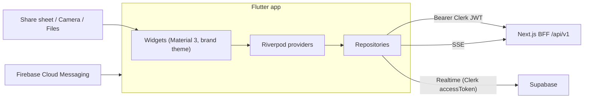

# 14 — PRD + SOP: VeriCite Mobile (Flutter, Phase 2)

> Starts **after** Phase 1 is complete and deployed. The mobile app is a **client of the same BFF** (`/api/v1/*`), same Clerk users, same Supabase data. **No new backend logic** except a few small endpoints listed below.

## Part A — PRD

### 1. Why mobile
Verification moments happen on the phone: a viral claim in WhatsApp, a reference list in a printed paper or slide, a quick check before a viva. Mobile adds **intake channels** the web can't: the **share sheet**, the **camera**, and **push notifications**.

### 2. Goals
1. Feature parity for viewing: history, live Trust Report, evidence, Grounded Answer.
2. Mobile-native intake: Share-to-VeriCite (text/URL/PDF), camera scan of a reference list (OCR), file picker.
3. Push notification when a run completes or (later) when watch mode finds a new retraction.

### 3. Non-goals
Offline verification, editing documents, tablet-specific layouts (it should just scale), payments.

### 4. Features

| ID | P | Feature | Notes |
|----|---|---------|-------|
| M-AUTH | P0 | Clerk sign-in (Google, email) | `clerk_flutter` SDK; session token sent as Bearer to the BFF |
| M-HOME | P0 | Home: "New check" actions (Scan, Upload PDF/.bib, Paste, Ask) + recent runs | |
| M-UPLOAD | P0 | File picker (PDF/.bib) → `POST /uploads/sign` → PUT → `POST /runs` | `file_picker` |
| M-PASTE | P0 | Paste text → run | |
| M-SHARE | P0 | Android/iOS share target: text → Ask or Paste; URL → Link run; PDF → upload run | `receive_sharing_intent` (or the current maintained equivalent) |
| M-SCAN | P1 | Camera → OCR (on-device ML Kit) → editable text → run as `text` | `google_mlkit_text_recognition`, `image_picker`/`camera` |
| M-REPORT | P0 | Live Trust Report: summary, filter chips, rows, evidence bottom sheet, fixes | Supabase Realtime via `supabase_flutter` with the Clerk `accessToken` |
| M-EXPORT | P0 | Share the corrected `.bib` / share link via the system share sheet | `share_plus` |
| M-ASK | P0 | Grounded Answer with streaming | SSE over `http` streamed response |
| M-PUSH | P1 | Push on run completion | FCM; new BFF endpoint `POST /api/v1/devices` + worker → BFF hook or Supabase DB webhook → FCM |
| M-WATCH | P2 | Watch mode alerts for new retractions | Depends on the backend cron |
| M-DARK | P1 | Dark theme (plum-deep) | Brand §3 |

### 5. New backend pieces (minimal)
| Endpoint / change | Purpose |
|-------------------|---------|
| BFF accepts `Authorization: Bearer` (verify via Clerk `authenticateRequest`) | Mobile auth |
| `POST /api/v1/devices` `{ fcmToken, platform }` → table `devices(owner_id, token, platform, created_at)` | Push |
| Supabase Database Webhook on `runs` status → `completed` → Vercel route `/api/hooks/run-completed` → FCM HTTP v1 | Push |

### 6. Screens
Splash (circle mark) → Sign in → Home → New check sheet (Scan / Upload / Paste / Link / Ask) → Report → Evidence sheet → Ask → History → Settings (account, theme, sign out).

### 7. Acceptance criteria
1. Share a WhatsApp text claim → VeriCite opens Ask prefilled → streamed grounded answer with sources.
2. Upload the demo PDF from Files → live report identical to the web (same run visible on web).
3. Scan a printed reference list photo → ≥ 90% of references OCR'd correctly → run completes.
4. Push arrives within 10 s of run completion (P1).
5. Works on Android 10+ and iOS 15+; 60 fps scrolling on a 40-row report.

## Part B — Architecture



### Project layout (`apps/mobile`)
```
lib/
├── main.dart
├── app/            # router (go_router), theme (brand tokens), env
├── core/           # api_client (dio + auth interceptor), sse_client, result types, errors
├── features/
│   ├── auth/       # clerk wrapper
│   ├── home/
│   ├── new_check/  # upload, paste, scan, share intake
│   ├── report/     # live report, evidence sheet, fixes, export
│   ├── ask/        # grounded answer stream
│   └── history/
└── shared/         # widgets: StatusBadge, ApiBadge, TrustScore, LogoMark, CircleDecor, QuoteBlock
```

### Packages
`flutter_riverpod` · `go_router` · `clerk_flutter` (+ `clerk_auth`) · `supabase_flutter` · `dio` · `file_picker` · `receive_sharing_intent` · `share_plus` · `google_mlkit_text_recognition` · `image_picker` · `firebase_core` + `firebase_messaging` (P1) · `flutter_svg` · `google_fonts` (Inter, IBM Plex Mono) · `freezed` + `json_serializable` (models) · `url_launcher` · `flutter_markdown`.

### Brand theme (Dart)
```dart
class VC {
  static const mist = Color(0xFFD8EAF7), plum = Color(0xFF4A2730), plumDeep = Color(0xFF36191F),
    plumMuted = Color(0xFF6B4A53), periwinkle = Color(0xFF96A9CC), cream = Color(0xFFF6F3E2),
    paper = Color(0xFFFBFAF3), linen = Color(0xFFF3EEE1), ok = Color(0xFF2F6B4F),
    warn = Color(0xFF8A5A12), bad = Color(0xFF9A3B3B);
}
// ColorScheme: primary plum / onPrimary cream / secondary periwinkle / onSecondary plum /
// surface paper / background mist / error bad. Cards radius 20, pills StadiumBorder.
```

### Models
Generate Dart models with `freezed` mirroring `apps/web/lib/contracts.ts` exactly (camelCase JSON). Enums with `@JsonValue('not_found')` etc. Unknown enum values → `unknown` (forward compatible).

## Part C — SOP (for AI agents)

Execute in order; each step has a Verify.

| # | Step | Verify |
|---|------|--------|
| F0 | `flutter create --org app.vericite --platforms=android,ios apps/mobile`; add packages; set up lints (`flutter_lints`); brand theme + fonts; `LogoMark` via `flutter_svg` | App launches with the Mist splash and the circle mark |
| F1 | Env config (`--dart-define` for `BFF_BASE_URL`, `SUPABASE_URL`, `SUPABASE_ANON_KEY`, `CLERK_PUBLISHABLE_KEY`) | Values readable at runtime; none hard-coded |
| F2 | Clerk auth (`ClerkAuth` wrapper, sign-in UI); `dio` interceptor adds `Authorization: Bearer <token>` (refresh on 401 once) | `GET /api/v1/runs` returns the same history as web |
| F3 | BFF: accept Bearer tokens on all `/api/v1/*` (Clerk `authenticateRequest`); add CORS not needed for mobile | curl with Bearer works |
| F4 | Models (`freezed`) + repositories (runs, citations, uploads, ask) | Unit tests parse fixture JSON from the web API |
| F5 | Home + History screens | List renders, pull-to-refresh |
| F6 | Upload/paste flows → create run → navigate to Report | Run appears on web too |
| F7 | Report: summary, chips, rows; Supabase Realtime subscription with `accessToken: () => clerk.sessionToken()`; polling fallback | Rows update live on device |
| F8 | Evidence bottom sheet, fixes, export via `share_plus` | Exported `.bib` opens in Files |
| F9 | Ask screen with SSE parsing (`status`, `sources`, `sentence`, `done`, `error`) | Streamed answer with cite chips + quote popovers |
| F10 | Share intent: text → Ask/Paste chooser; URL → Link run; PDF → upload | Sharing from Chrome/WhatsApp opens the right flow |
| F11 | (P1) Camera OCR → editable text → run | Demo reference photo OCR ≥ 90% |
| F12 | (P1) FCM: `devices` table + endpoint, webhook route, notification tap → Report | Push on completion |
| F13 | Polish: dark theme, empty/error states, accessibility (semantics labels for badges), app icons (`flutter_launcher_icons`), splash (`flutter_native_splash`) | Store-ready debug builds |
| F14 | Builds: Android APK/AAB (`flutter build apk --release`), iOS via Xcode/TestFlight if an account exists | APK installs on a physical device |

### Mobile UX notes
- Report rows: tap → **bottom sheet** evidence (not inline expansion) for thumb reach.
- Sticky summary header collapses to `87% · 5 flagged` while scrolling.
- Haptic feedback when a run completes; long-press on a quote copies it.
- Share intake must work cold-start (app not running) and warm.
